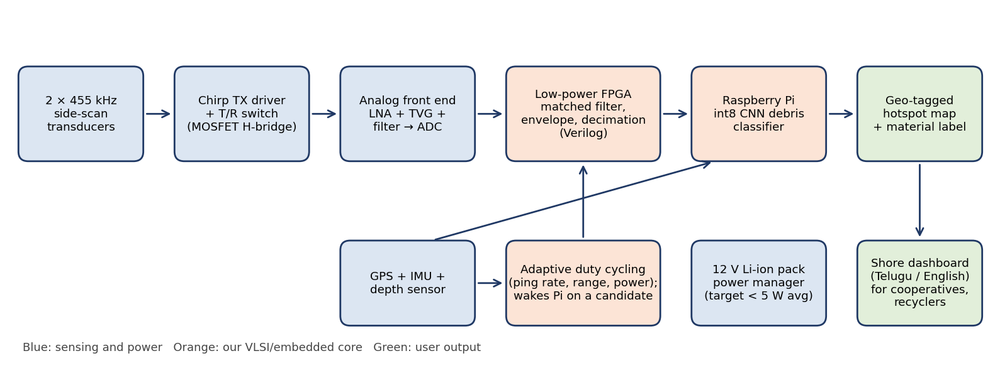
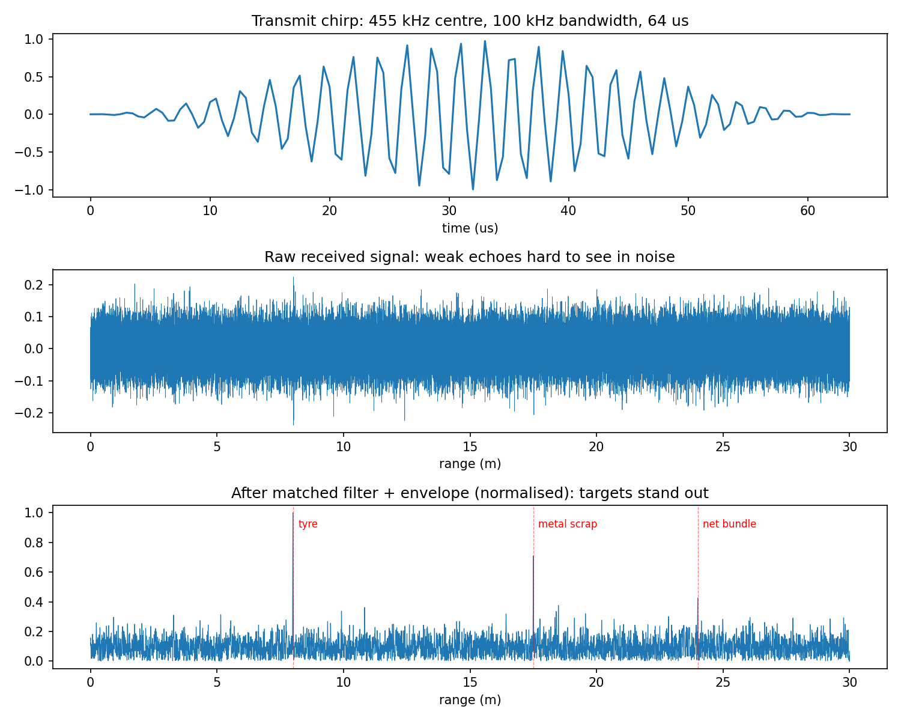
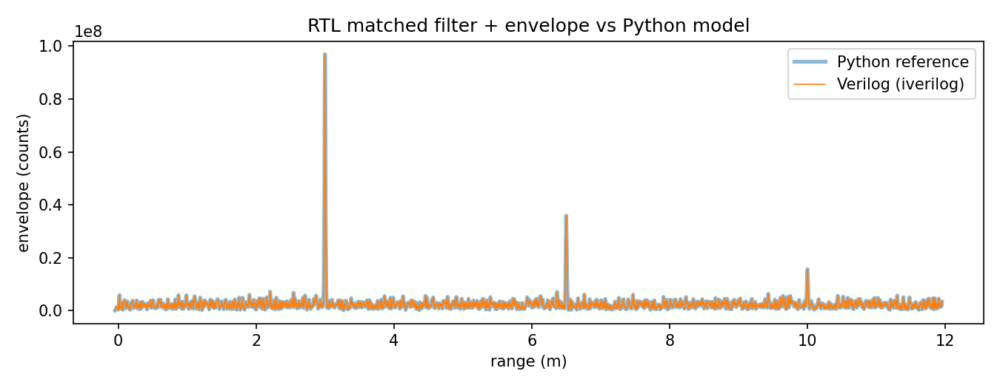
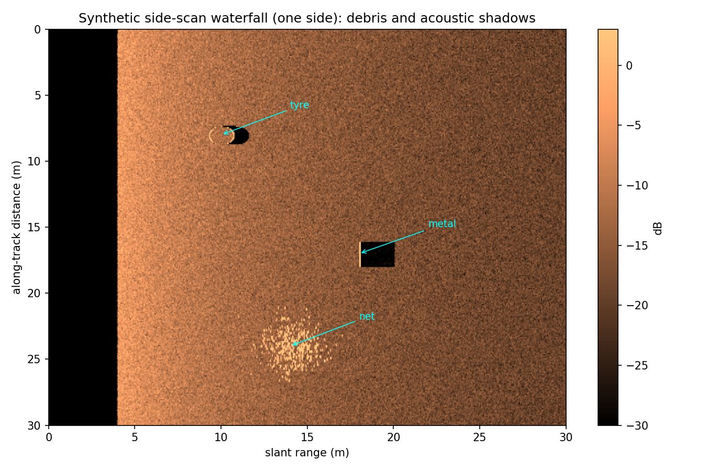
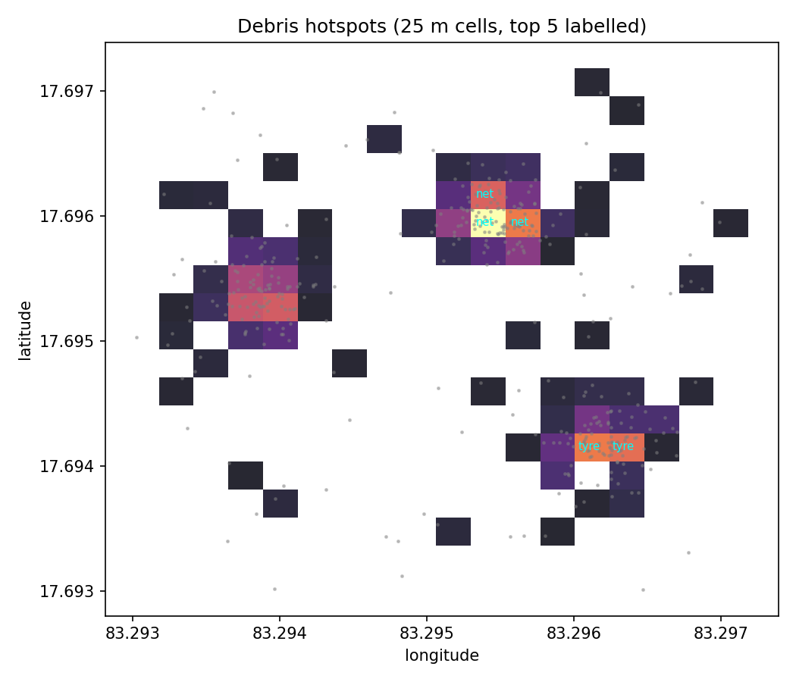

# Hermes Sonar

**A low-cost, low-power side-scan sonar payload for mapping seabed debris and enabling circular-economy recovery of marine waste.**

Team Hermes · Chaitanya Bharathi Institute of Technology (CBIT), Hyderabad · Seva First Innovation Challenge 2026

---

## The problem

Lost fishing nets, tyres and scrap settle on the seabed of harbours and nearshore fishing grounds, where they keep trapping fish, snagging working nets and breaking down into microplastics. About 5.7% of all fishing nets are lost at sea each year ([ref 1](docs/references.md)). Almost none of this is mapped, because survey-grade sonar costs lakhs of rupees and cameras fail in turbid harbour water.

## Our approach

A compact sonar payload (target ~₹35,000 per unit, under 5 W average) that mounts on a small boat, ROV or AUV and:

1. sends 455 kHz chirp pulses and compresses the echoes on a **low-power FPGA** (our VLSI core),
2. wakes a Raspberry Pi **only when the FPGA flags a candidate object** (adaptive duty cycling),
3. classifies debris (tyre, net, metal) with a small int8 neural network, and
4. outputs a **GPS-tagged hotspot map** labelled by recyclable material, for cleanup teams and recyclers.



## Project status

| Area | Status | Where |
|---|---|---|
| System architecture and component selection | Done | `docs/` |
| Chirp + matched-filter signal simulation | Done | `sim/chirp_matched_filter.py` |
| Synthetic side-scan waterfall images | Done (toy model) | `sim/waterfall_sim.py` |
| Verilog matched filter + envelope/decimation | Done, bit-exact vs Python **in simulation** | `rtl/` |
| Duty-cycling controller and power model | Reference model done, uses **assumed** power numbers | `firmware/` |
| Hotspot mapping (GeoJSON + heatmap) | Done, tested on **synthetic** detections | `mapping/` |
| Analog front end + TX driver schematic | Planned (Nov 2026) | `hardware/` |
| FPGA synthesis on ECP5 + folded low-power FIR | Planned (Nov 2026) | `rtl/` |
| Debris classifier | Planned: dataset spec written | `ml/` |
| Tank tests at CBIT | Planned (Dec 2026) | — |
| Field pilot (Hussain Sagar, then Visakhapatnam) | Planned (Jan–Apr 2027) | — |

Nothing has been tested in water yet. All performance numbers in this repo are simulation results or targets unless marked measured.

## Results so far (simulation)

**Pulse compression.** Echoes buried in noise become clear peaks after the matched filter. Theoretical range resolution is 0.75 cm (c/2B with 100 kHz bandwidth); real resolution will be limited by beam width and the AFE.



**RTL verification.** The Verilog matched filter (128 taps, 12-bit in, 32-bit accumulator) and envelope/decimation block match the Python model with zero mismatches over a 32,000-sample ping in Icarus Verilog.



**Synthetic waterfall.** A toy side-scan model with a tyre, metal scrap and a net, including acoustic shadows. Used to prototype the classifier pipeline before real data exists.



**Hotspot map.** Detections are gridded into 25 m cells, scored by confidence and labelled with the dominant recyclable material.



## Quick start

```bash
pip install -r sim/requirements.txt

# signal simulations
cd sim
python chirp_matched_filter.py
python waterfall_sim.py

# RTL: export vectors, simulate with Icarus Verilog, compare with Python
cd ../rtl
make            # needs iverilog (sudo apt install iverilog)

# power model
cd ../firmware
python duty_cycle_sim.py

# hotspot map from synthetic detections
cd ../mapping
python hotspot_map.py --demo
```

## Repository layout

```
docs/       concept note, design notes, references, images
sim/        signal parameters, simulations, RTL test-vector export and comparison
rtl/        Verilog matched filter, envelope/decimation, testbench, Makefile
hardware/   bill of materials, AFE plan (schematics to come)
firmware/   duty-cycling controller reference model
ml/         debris classes and dataset plan
mapping/    detections -> hotspot GeoJSON + heatmap
```

## Team

| Member | Role |
|---|---|
| D. Venkat Sai Karthik (lead) | System architecture, FPGA signal processing (Verilog) |
| S. Santhoosh Maadhur | Analog front end and PCB design |
| G. Tejas | Embedded firmware and power management |
| K. Prabas Reddy | Debris classifier and mapping software |
| Bhaavana | Housing, test planning, field coordination, benchmarking |

All members: B.E. Electronics and Communication Engineering (VLSI Design), 3rd year, CBIT Hyderabad.

## Roadmap

- **Nov–Dec 2026:** AFE and FPGA boards, folded low-power FIR on ECP5, housing, tank tests with planted tyres, nets and metal (target TRL 4).
- **Jan–Apr 2027:** lake trials at Hussain Sagar, harbour pilot at Visakhapatnam with a cooperative or NGO, diver ground truth.
- **May–Dec 2027:** custom PCB, 5 units with a first adopter, recycler tie-up.

## License

Code: MIT (see `LICENSE`). Hardware design files, once added, will be released under CERN-OHL-P v2.
